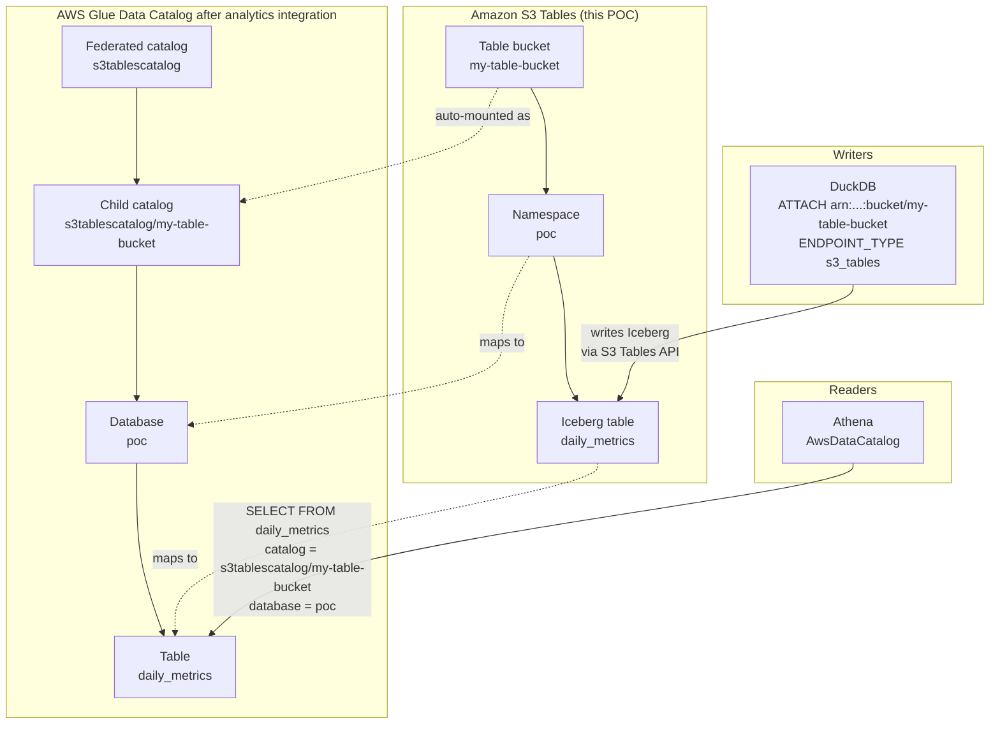

# DuckDB + Iceberg + MinIO POC

Small Python POC that writes to **Apache Iceberg** through DuckDB’s `iceberg` extension, with **MinIO** standing in for S3 and the **Iceberg REST** fixture as the catalog (same pattern as `apache_flink`).

The demo loads JSON seed data, then runs **`MERGE INTO`** upserts keyed by **`(id, event_date)`** so you can see updates vs inserts in one statement.

## Prerequisites

- Docker and Docker Compose
- Optional (host runs): Python 3.12+ and `pip install -r requirements.txt`

## Related: moto S3 Tables experiment

See [`moto_s3tables/`](./moto_s3tables/) for a **separate** experiment using [moto](https://github.com/getmoto/moto) to mock the S3 Tables **control-plane** API (boto3). That path does **not** replace this MinIO stack: DuckDB’s `ENDPOINT_TYPE s3_tables` needs AWS’s Iceberg REST facade, which moto does not implement yet.

## Quick start (Docker)

```bash
cd duckdb-iceberg
docker compose up --build
```

This starts MinIO (API `localhost:19200`, console `19201`), Iceberg REST (`localhost:18282`), and runs `scripts/run_demo.py` in the `demo` service.

Expected outcome:

- **4 rows** after the initial load
- **5 rows** after the merge (new `1004 / 2025-10-02`)
- Madrid `2025-10-01` **`metric_value`** changes from `1200` → **`1300`**

Re-run the demo (stack already up):

```bash
./scripts/demo.sh
# or: docker compose run --rm demo
```

Re-runs reuse the same Iceberg table and clear rows with `DELETE` (avoids fragile `DROP` against the REST fixture).

## Quick start (host Python)

Start infrastructure without the demo container:

```bash
docker compose up -d minio minio-init iceberg-rest
```

Then:

```bash
python -m venv .venv && source .venv/bin/activate
pip install -r requirements.txt
export PYTHONPATH=src
python scripts/run_demo.py
```

Default config is `config/local.yaml` (localhost ports).

## Query an existing table

Same `CONFIG_PATH` switch as the demo — MinIO locally or S3 Tables on AWS:

```bash
export PYTHONPATH=src

# Local (MinIO + REST) — default config/local.yaml
docker compose up -d minio minio-init iceberg-rest
python scripts/query.py
python scripts/query.py --list-tables
python scripts/query.py -q "SELECT id, event_date, metric_value FROM lake.poc.daily_metrics"

# AWS S3 Tables
export CONFIG_PATH=config/aws.yaml
python scripts/query.py
python scripts/query.py -q "SELECT count(*) FROM lake.playground.daily_metrics"
```

Without `-q`, it runs `SELECT * … LIMIT 50` on the table from config (`table.namespace` / `table.name`).

## Configuration

| File | Purpose |
|------|---------|
| `config/local.yaml` | MinIO + REST on localhost (host runs) |
| `config/docker.yaml` | Same stack, Docker service hostnames |
| `config/aws_s3_tables.example.yaml` | Template for **Amazon S3 Tables** (`ENDPOINT_TYPE s3_tables`) |
| `config/aws_rest.example.yaml` | Template for a **real Iceberg REST** catalog on AWS S3 |

Select a file with:

```bash
export CONFIG_PATH=config/local.yaml
```

Environment variables override YAML (useful in CI or compose):

- `ICEBERG_REST_URI`, `ICEBERG_WAREHOUSE`, `S3_ENDPOINT`
- `AWS_ACCESS_KEY_ID`, `AWS_SECRET_ACCESS_KEY`, `AWS_REGION`
- `ICEBERG_NAMESPACE`, `ICEBERG_TABLE`

## Pointing at real AWS (S3 Tables or Iceberg REST)

The local MinIO stack is only for development. To run the **same** `scripts/run_demo.py` against AWS, you pick one of two catalogs, copy a template, fill values, and set `CONFIG_PATH`. Do this on your **host** (not inside the MinIO compose demo), so AWS credentials from your laptop / SSO / IAM role apply.

### Prerequisites (both options)

1. Python 3.12+ with the POC deps:

```bash
cd duckdb-iceberg
python -m venv .venv && source .venv/bin/activate
pip install -r requirements.txt
export PYTHONPATH=src
```

2. AWS credentials available to DuckDB (`provider: credential_chain` uses the normal chain: env vars → shared credentials → SSO → assume-role profiles → instance/role).

List configured profiles (names come from `~/.aws/config` and `~/.aws/credentials`):

```bash
aws configure list-profiles
# or: cat ~/.aws/config
```

**Use the profile that has permissions**, not necessarily the one that stores long-lived keys.

Common pattern (keys in `~/.aws/credentials` + assume-role in `~/.aws/config`):

```ini
# ~/.aws/credentials
[default]
aws_access_key_id = ...
aws_secret_access_key = ...

# ~/.aws/config
[profile poc-dev]
role_arn = arn:aws:iam::ACCOUNT_ID:role/YourDevRole
source_profile = default
role_session_name = your-session
region = eu-west-1
output = json
```

Here you export **`poc-dev`** (the profile with `role_arn`). The CLI/DuckDB will use the keys from `source_profile` only to call `AssumeRole`, then operate as that role:

```bash
export AWS_PROFILE=poc-dev
export AWS_REGION=eu-west-1
aws sts get-caller-identity
# Arn should show assumed-role/YourDevRole — not the root/user from credentials alone
```

Example with SSO instead:

```bash
aws sso login --profile your-profile
export AWS_PROFILE=your-profile
export AWS_REGION=eu-west-1
aws sts get-caller-identity
```

3. Create a **private** config from a template (gitignored — never commit secrets), then **edit the copy**:

```bash
# choose ONE of the two paths below
cp config/aws_s3_tables.example.yaml config/aws.yaml
# or
cp config/aws_rest.example.yaml config/aws.yaml
```

`export CONFIG_PATH=config/aws.yaml` only tells the script **which file to load**. You must still replace placeholders in **`config/aws.yaml`** (leave the `.example.yaml` files untouched).

For S3 Tables, change at least:

| Field | What to put |
|-------|-------------|
| `iceberg.attach_path` | Your real table bucket ARN from S3 → Table buckets (not `s3://…`, not the example `111122223333` / `your-table-bucket`) |
| `storage.region` | Same region as in the ARN |
| `table.namespace` / `table.name` | Optional; defaults `poc` / `daily_metrics` |

Example after editing:

```yaml
iceberg:
  attach_path: "arn:aws:s3tables:eu-west-1:123456789012:bucket/my-real-table-bucket"
  catalog_alias: lake
  endpoint_type: s3_tables

storage:
  region: eu-west-1
  provider: credential_chain
```

4. Run (profile + config together):

```bash
export AWS_PROFILE=poc-dev          # your assume-role / SSO profile
export AWS_REGION=eu-west-1
export CONFIG_PATH=config/aws.yaml       # the edited file, not the .example
python scripts/run_demo.py
```

The script will create namespace/table `poc.daily_metrics` (or whatever you set under `table:`), load seeds, and run the MERGE upsert demo against AWS.

---

### Option A — Amazon S3 Tables (simplest AWS path)

Use this if you have an **S3 Table Bucket** and want DuckDB’s built-in `ENDPOINT_TYPE s3_tables`.

1. In AWS Console → **Amazon S3** → **Table buckets**, create or open a table bucket.
2. Copy the **table bucket ARN** (format below). This is **not** an `s3://` URI:

```text
arn:aws:s3tables:REGION:ACCOUNT_ID:bucket/TABLE_BUCKET_NAME
```

3. Ensure the IAM principal you use can manage S3 Tables for that bucket (typical actions include `s3tables:*` on the table bucket / tables, plus whatever your org already uses for S3 Tables). Write access is required for this demo.
4. Edit `config/aws.yaml`:

```yaml
profile: aws_s3_tables

iceberg:
  attach_path: "arn:aws:s3tables:eu-west-1:123456789012:bucket/my-table-bucket"
  catalog_alias: lake
  endpoint_type: s3_tables

storage:
  region: eu-west-1
  provider: credential_chain

table:
  namespace: poc          # becomes the S3 Tables namespace
  name: daily_metrics   # becomes the table name
```

5. Run:

```bash
export CONFIG_PATH=config/aws.yaml
export AWS_PROFILE=your-profile   # if not already set
export AWS_REGION=eu-west-1
python scripts/run_demo.py
```

6. Verify in Console (S3 Tables → namespace `poc` → table `daily_metrics`) or with Athena if you have an S3 Tables integration.

**Notes**

- Do **not** set `rest_uri` or MinIO `endpoint` for this option.
- `READ_ONLY false` is already applied in code so writes work.
- If attach fails with auth errors, check region matches the ARN and `aws sts get-caller-identity` returns the account you expect.

#### Querying the same S3 Tables from Athena (via Glue)

Athena does **not** attach to the table bucket the way DuckDB does (`ENDPOINT_TYPE s3_tables`). In production you enable the **S3 Tables ↔ AWS analytics** integration, which registers a federated catalog in **AWS Glue Data Catalog**. Athena then queries through Glue (and Lake Formation for permissions). See [Glue federation with S3 Tables](https://docs.aws.amazon.com/glue/latest/dg/glue-federation-s3tables.html).

**How this POC maps onto that hierarchy** (defaults from `config/aws_s3_tables.example.yaml`: namespace `poc`, table `daily_metrics`; replace `my-table-bucket` with your real table bucket name):



Glue path for this POC (same account/region):

```text
s3tablescatalog / my-table-bucket / poc / daily_metrics
       ▲                 ▲           ▲          ▲
  federated         child catalog  database    table
  catalog           (= table       (= S3       (= S3 table)
  (auto-created)     bucket)        namespace)
```

Athena SQL shape:

```sql
SELECT *
FROM "s3tablescatalog/my-table-bucket".poc.daily_metrics
LIMIT 10;
```

| This POC (S3 Tables) | Glue / Athena name |
|----------------------|--------------------|
| Federated parent (integration) | `s3tablescatalog` |
| Table bucket `my-table-bucket` | Child catalog `s3tablescatalog/my-table-bucket` |
| Namespace `poc` | Database `poc` |
| Table `daily_metrics` | Table `daily_metrics` |

Steps:

1. **Once per account/region:** in the S3 console → **Table buckets** → enable **Integrate with AWS analytics services** (creates `s3tablescatalog` in Glue for that region).
2. Grant the Athena principal permissions on Glue + S3 Tables (and Lake Formation if your org uses it).
3. In the Athena query editor:
   - Data source: `AwsDataCatalog`
   - Catalog: `s3tablescatalog/<your-table-bucket-name>`
   - Database: the namespace from this POC (`poc` by default)
4. Run e.g. `SELECT * FROM daily_metrics LIMIT 10;`

Shortcut: open the table in S3 Tables and choose **Query table with Athena** (pre-fills catalog/database).

You do **not** need to run your own Iceberg REST service for this path. DuckDB writes via S3 Tables; Athena reads the same tables via the Glue federation.

AWS docs:

- [S3 Tables integration with AWS analytics services (overview)](https://docs.aws.amazon.com/AmazonS3/latest/userguide/s3-tables-integration-overview.html)
- [Querying Amazon S3 tables with Athena](https://docs.aws.amazon.com/AmazonS3/latest/userguide/s3-tables-integrating-athena.html)
- [Register S3 table bucket catalogs and query from Athena](https://docs.aws.amazon.com/athena/latest/ug/gdc-register-s3-table-bucket-cat.html)
- [Glue Data Catalog federation with S3 Tables](https://docs.aws.amazon.com/glue/latest/dg/glue-federation-s3tables.html)

---

### Option B — Iceberg REST catalog + S3 warehouse (Glue REST / Polaris / Lakekeeper / etc.)

Use this if a REST catalog already manages Iceberg tables whose data lives in a normal S3 bucket.

1. Collect from your platform team / console:
   - Warehouse path, e.g. `s3://my-iceberg-warehouse/`
   - Catalog REST URL, e.g. `https://catalog.example.com`
   - Auth: OAuth2 client id/secret + token URL, **or** SigV4 (Glue), depending on the catalog
2. Edit `config/aws.yaml` from `aws_rest.example.yaml`:

```yaml
profile: aws_rest

iceberg:
  attach_path: s3://my-iceberg-warehouse/
  catalog_alias: lake
  rest_uri: https://catalog.example.com
  authorization_type: oauth2          # or sigv4 / none — match your catalog
  oauth2_server_uri: https://catalog.example.com/v1/oauth/tokens
  client_id: YOUR_CLIENT_ID
  client_secret: YOUR_CLIENT_SECRET
  access_delegation_mode: vended_credentials

storage:
  region: eu-west-1
  provider: credential_chain

table:
  namespace: poc
  name: daily_metrics
```

3. IAM for the storage side must allow read/write on the warehouse bucket (and KMS if the bucket is encrypted). Catalog credentials are separate (OAuth / SigV4).
4. Run the same way:

```bash
export CONFIG_PATH=config/aws.yaml
python scripts/run_demo.py
```

**Glue Data Catalog Iceberg REST tip:** many Glue setups use SigV4 instead of OAuth2. In that case set `authorization_type: sigv4`, drop `client_id` / `client_secret` / `oauth2_server_uri`, keep `provider: credential_chain`, and set `rest_uri` to the Glue Iceberg REST endpoint for your region. If attach options differ for your Glue setup, adjust `config/aws.yaml` and the `ATTACH` options in `src/duckdb_iceberg/session.py` accordingly.

---

### Optional: static keys instead of credential chain

Only if you cannot use SSO / profiles. Prefer env vars over putting keys in YAML:

```bash
export AWS_ACCESS_KEY_ID=...
export AWS_SECRET_ACCESS_KEY=...
export AWS_SESSION_TOKEN=...   # if using temporary creds
export AWS_REGION=eu-west-1
```

Or in `config/aws.yaml`:

```yaml
storage:
  region: eu-west-1
  provider: static
  access_key_id: "..."
  secret_access_key: "..."
```

`config/aws.yaml` is gitignored; still avoid committing secrets.

---

### What the demo will do on AWS

Same as local:

1. Attach catalog as `lake`
2. `CREATE SCHEMA` / table `poc.daily_metrics` if missing (or `DELETE` + reload if it already exists and is readable)
3. Insert seed rows → `MERGE` upsert on `(id, event_date)` → print checks

If the table already exists in prod with a different schema, either change `table.name` in `aws.yaml` to a disposable POC name, or reset that table outside this script.

## Seed data

- `seeds/initial_metrics.json` — first ingest (daily metrics per city)
- `seeds/upsert_batch.json` — merge batch: two updates + one insert (see `_note` fields in JSON)

## How upserts work

DuckDB does not use primary keys on Iceberg tables; **`MERGE INTO`** is the supported upsert pattern. The join condition is **`id` + `event_date`**, so the same logical metric on another day is a separate row.

Table properties are set to **`merge-on-read`** for updates/deletes, as required by DuckDB’s Iceberg writer.

## Ports

| Service | Host port |
|---------|-----------|
| MinIO S3 API | 19200 |
| MinIO console | 19201 |
| Iceberg REST | 18282 |

## Troubleshooting

**Stuck waiting for REST / HTTP 500 on table load:** Reset volumes and orphans, then rebuild:

```bash
docker compose down -v --remove-orphans
docker compose up --build
```
